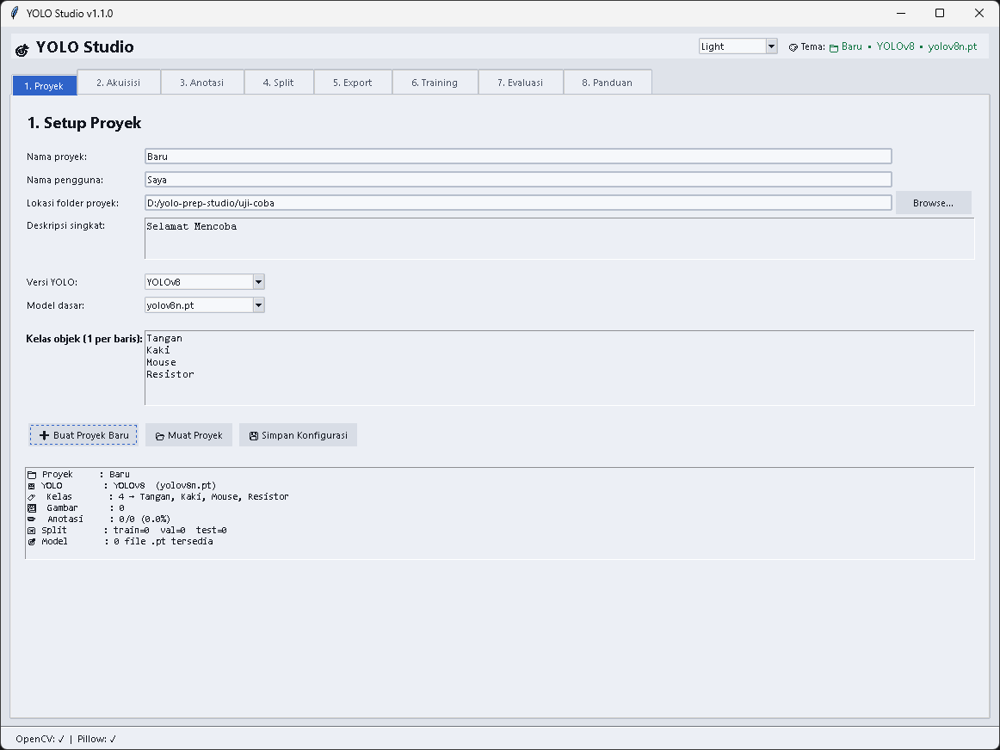
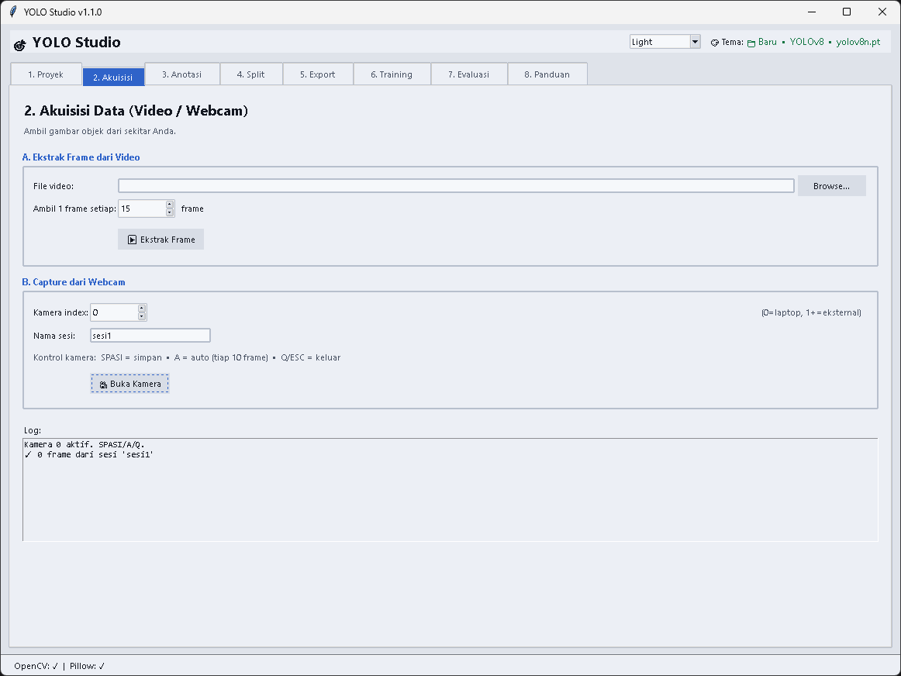
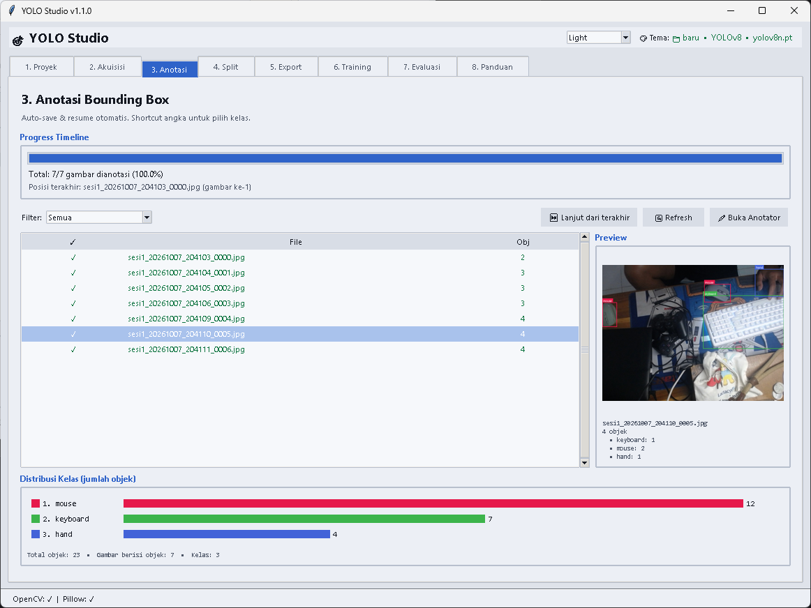

# 🎯 YOLO Studio

[](https://github.com/yogidm/yolo-prep-studio)
[](https://opensource.org/licenses/MIT)
[](https://www.python.org/)
[](https://github.com/yogidm/yolo-prep-studio/releases/latest)

Aplikasi desktop untuk mempersiapkan dataset deteksi objek dan melatih model YOLO...

## 🚀 Download

| Cara | Link |
|------|------|
| 📦 **Download ZIP rilis terbaru** | [**⬇️ Klik di sini**](https://github.com/yogidm/yolo-prep-studio/releases/latest) |
| 📄 Lihat semua rilis | [Semua Releases](https://github.com/yogidm/yolo-prep-studio/releases) |
| 🌐 Clone via Git | `git clone https://github.com/yogidm/yolo-prep-studio.git` |
---

## ✨ Fitur

| Fitur | Deskripsi |
|-------|-----------|
| 📥 **Akuisisi** | Capture dari webcam laptop/eksternal, ekstrak frame dari video |
| ✏️ **Anotasi** | Drag mouse, auto-save, resume, shortcut lengkap (1-9, Space, B, N, D, C) |
| 🤖 **Semi-Otomatis** | Auto-suggest bbox dengan YOLO COCO (`Ctrl+A`) untuk kelas umum |
| 🎨 **4 Tema** | Midnight, Nord, Dracula, Light — warna tetap per kelas |
| 📊 **Progress Timeline** | Progress bar + filter + distribusi kelas dengan warna |
| 🔀 **Split Fleksibel** | Rasio numerik (persen) dengan live-count dan preset |
| 📦 **Export** | Folder `yolo_dataset/` siap-upload ke Google Drive |
| 📓 **Notebook Generator** | `.ipynb` otomatis sesuai versi YOLO (v5/v8/v9/v10/v11) |
| 🎯 **Evaluasi Lengkap** | Uji mAP/precision/recall, prediksi gambar/video/kamera real-time |
| 📥 **Import Hasil Training** | ZIP dari Colab → viewer metrik + grafik di dalam aplikasi |
| 📚 **Panduan Bawaan** | 9 sub-tab referensi lengkap langsung di dalam aplikasi |

---

## 📸 Tangkapan Layar

### Tab Proyek — Setup awal proyek & kelas


### Tab Akuisisi — Ekstrak frame dari video atau capture webcam


### Tab Anotasi — Bounding box dengan warna tetap per kelas


---

## 🚀 Instalasi

**Prasyarat:** Python 3.9+ dan pip.

```bash
git clone https://github.com/yogidm/yolo-prep-studio.git
cd yolo-prep-studio

# Buat virtual environment (opsional tapi disarankan)
python -m venv .venv
# Windows:  .venv\Scripts\activate
# Linux/mac: source .venv/bin/activate

# Install dependensi wajib
pip install -r requirements.txt

# (Opsional) untuk auto-suggest & evaluasi
pip install -r requirements-full.txt
```

---

## ▶️ Menjalankan

```bash
python yolo_studio.py
```

Atau lewat script bantu:

- **Windows**: `scripts\run.bat`
- **Linux/macOS**: `./scripts/run.sh`

---

## 📚 Alur Penggunaan

```
┌─────────────────────────────────────────────────────┐
│  1. Proyek   →  buat proyek, isi kelas, pilih YOLO  │
│  2. Akuisisi →  capture webcam / ekstrak video      │
│  3. Anotasi  →  drag bbox, auto-suggest, auto-save  │
│  4. Split    →  atur rasio train/val/test           │
│  5. Export   →  susun folder + data.yaml            │
│  6. Training →  generate notebook, jalankan Colab   │
│  7. Evaluasi →  uji best.pt + import hasil training │
│  8. Panduan  →  referensi lengkap di dalam aplikasi │
└─────────────────────────────────────────────────────┘
```

### Detail Singkat Tiap Tab

1. **Proyek** — isi nama proyek, nama peneliti, folder kerja, pilih versi YOLO, dan daftar kelas (1 per baris). Klik *Buat Proyek Baru* → struktur folder otomatis terbentuk.

2. **Akuisisi** — dua cara mengumpulkan data:
   - **Video**: pilih file `.mp4`/`.avi`/`.mov`, atur interval frame (default 1 frame per 15), klik *Ekstrak Frame*.
   - **Webcam**: pilih index kamera (0 = laptop, 1+ = eksternal), beri nama sesi, klik *Buka Kamera*. Kontrol: `SPASI` simpan, `A` toggle auto, `Q` keluar.

3. **Anotasi** — buka Anotator, pilih kelas (atau tekan angka `1`-`9`), drag mouse untuk kotak. Anotasi **tersimpan otomatis** setiap perubahan. Kalau aplikasi ditutup lalu dibuka lagi, anotator **melanjutkan dari gambar terakhir**. Progress bar dan distribusi kelas tampil langsung.

4. **Split** — pilih preset (70/20/10, dst) atau isi angka manual (total harus 100%). Live-count menampilkan estimasi jumlah gambar per split. Random seed menjamin reproducibility.

5. **Export** — klik *Susun Folder Export + data.yaml* → folder `04_export/yolo_dataset/` siap. Upload folder tersebut ke Google Drive di `MyDrive/yolo_projects/<nama_proyek>/yolo_dataset/`.

6. **Training** — pilih versi YOLO (v5/v8/v9/v10/v11) dan model (n/s/m/l/x), atur hyperparameter, klik *Generate Notebook*. Upload `.ipynb` ke [colab.research.google.com](https://colab.research.google.com), ganti runtime ke T4 GPU, jalankan cell. `best.pt` + `train_results.zip` otomatis terunduh di akhir.

7. **Evaluasi** — muat `best.pt`, lalu:
   - **🎯 Uji pada Split Test** → hitung mAP, precision, recall
   - **📊 Analisis results.csv** → metrik per epoch
   - **🖼 Prediksi Gambar** → uji gambar tunggal
   - **🎬 Prediksi Video** → prediksi seluruh frame video
   - **🎥 Prediksi Kamera** → real-time webcam dengan FPS counter
   - **📥 Import Hasil Training (ZIP)** → ekstrak + viewer grafik dari Colab
   - **📂 Lihat Hasil Training Terakhir** → buka kembali eksperimen sebelumnya

8. **Panduan** — referensi lengkap 9 sub-tab (Alur, Akuisisi, Anotasi Manual, Semi-Auto, Shortcut, Split & Export, Training, Evaluasi, Tips & FAQ). Bisa disalin ke clipboard atau disimpan sebagai file teks.

---

## ⌨️ Shortcut Anotator

| Tombol | Fungsi |
|--------|--------|
| `1` … `9` | Pilih kelas 1–9 |
| `0` | Pilih kelas ke-10 |
| `Space` | Simpan & lanjut ke gambar berikutnya |
| `B` | Gambar sebelumnya |
| `N` | Gambar berikutnya |
| `D` / `Delete` | Undo kotak terakhir |
| `C` | Hapus semua kotak di gambar |
| `Ctrl+S` | Simpan tanpa pindah |
| `Ctrl+A` | Auto-suggest bbox (butuh `ultralytics`) |
| `Enter` | Terima semua usulan auto-suggest |
| `Esc` | Tolak semua usulan |
| Klik kanan | Terima 1 usulan auto-suggest |
| `←` `→` | Navigasi prev/next |

---

## 🎨 Tema

Pilih tema dari dropdown di kanan atas header:

| Tema | Karakter |
|------|----------|
| **Midnight** | Biru gelap adem (default) |
| **Nord** | Abu-biru Skandinavia |
| **Dracula** | Ungu gelap, kontras tinggi |
| **Light** | Abu terang untuk ruangan terang |

Tema terakhir **disimpan otomatis** di `~/.yolo_studio_config.json` dan dimuat saat aplikasi dibuka lagi.

---

## 📁 Struktur Folder Proyek

Setelah membuat proyek, folder yang terbentuk:

```
<nama_proyek>/
├── project.json               # metadata proyek
├── 01_raw/
│   ├── frames/                # gambar mentah hasil akuisisi
│   └── labels/                # anotasi YOLO (.txt)
├── 02_split/
│   ├── images/{train,val,test}/
│   └── labels/{train,val,test}/
├── 04_export/
│   └── yolo_dataset/          # folder siap upload ke Drive
├── 05_models/                 # best.pt hasil Colab
├── 06_runs/                   # hasil training (import dari Colab)
│   └── train_<timestamp>/     # satu folder per eksperimen
├── notebooks/                 # .ipynb yang digenerate
└── configs/                   # data.yaml, dll
```

---

## ⚙️ Dependensi

**Wajib** (`requirements.txt`):
- `opencv-python` — capture webcam, ekstrak frame, prediksi video/kamera
- `Pillow` — anotasi & preview gambar

**Opsional** (`requirements-full.txt`):
- `ultralytics` — untuk auto-suggest bbox COCO, evaluasi `.pt`, prediksi video/kamera

---

## 🛠️ Troubleshooting

**Webcam tidak terdeteksi**
Coba ganti index kamera di tab Akuisisi (0, 1, 2). Tutup aplikasi lain yang mungkin memakai kamera (Zoom, Teams).

**Auto-suggest tidak jalan**
`pip install ultralytics`. Pastikan minimal 1 kelas proyek Anda ada di daftar COCO (mis. `person`, `car`, `bottle`).

**Colab error "CUDA out of memory"**
Turunkan batch size (16 → 8 → 4) atau imgsz (640 → 416) di tab Training.

**Split menghasilkan 0 gambar di val/test**
Dataset terlalu kecil. Kumpulkan minimal 10-20 gambar teranotasi dulu.

**Uji pada Split Test error "images not found, missing path"**
Bug lama — sudah diperbaiki di v1.1.0. Update ke versi terbaru.

**Prediksi video/kamera lambat**
Gunakan model `yolov8n.pt` (nano). Turunkan `imgsz` ke 416 untuk performa lebih tinggi.

**Hasil training tidak muncul di tab Evaluasi**
Import dulu via **📥 Import Hasil Training (ZIP)** — pilih `train_results.zip` yang diunduh dari Colab.

---

## 📖 Sumber Belajar

- Dokumentasi YOLO: https://docs.ultralytics.com/
- Paper YOLOv8: Jocher, G. et al. (2023). *Ultralytics YOLOv8*
- Paper YOLOv9: Wang, C. et al. (2024)
- Paper YOLOv10: Wang, A. et al. (2024)
- Tutorial Colab: cari "YOLOv8 custom dataset colab" di YouTube

---

## 📄 Lisensi

MIT — lihat [LICENSE](LICENSE).

---

## 🤝 Kontribusi

Pull request dan issue sangat diterima. Untuk perubahan besar, silakan buka issue terlebih dahulu untuk mendiskusikan apa yang ingin diubah.

### Cara kontribusi

```bash
# Fork repo di GitHub, lalu:
git clone https://github.com/<username-anda>/yolo-prep-studio.git
cd yolo-prep-studio
git checkout -b feat/nama-fitur-anda

# ... edit file ...

git add .
git commit -m "feat: tambah fitur X"
git push origin feat/nama-fitur-anda
```

Lalu buat Pull Request di GitHub.

---

## 🙏 Kredit

Dibuat untuk mempermudah workflow deteksi objek berbasis YOLO tanpa ketergantungan layanan pihak ketiga.

Terima kasih untuk **Ultralytics** atas framework YOLO yang luar biasa.

---

**Selamat berkarya!** 🎉